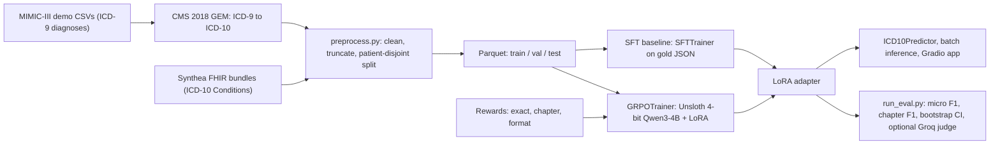

# ClinicalGRPO

Reinforcement learning post-training of Qwen3-4B-Instruct with GRPO (Group Relative Policy Optimization) to assign ICD-10-CM codes to clinical discharge summaries, scored by a rule-based, verifiable reward instead of an LLM judge.

[](https://github.com/TirtheshJani/ClinicalGRPO/actions/workflows/ci.yml)
[](LICENSE)
[](pyproject.toml)

Reinforcement learning with verifiable rewards (RLVR) is usually demonstrated on GSM8K-style math, where the answer is a single number. This project applies it to medical coding. The model reads a discharge summary and answers with `{"codes": [...]}`, and the reward comes from parsing that JSON and comparing the codes to the gold ICD-10 set.

Training runs TRL's `GRPOTrainer` on a 4-bit Unsloth model with LoRA, sized for a single 16 GB RTX 4080. An SFT baseline on the same LoRA setup is the comparison point. The data pipeline handles the MIMIC-III demo (ICD-9 diagnoses mapped to ICD-10) and Synthea FHIR bundles.

Status: the data, reward, training, evaluation, and serving code is implemented, and the CPU test suite passes in CI. No training run has been completed yet, so there are no results to report.

## Highlights

- A three-part verifiable reward in [`rewards/composite.py`](src/clinical_grpo/rewards/composite.py): exact-code recall, partial credit for non-gold predictions that share a gold code's ICD-10 chapter (less a hallucination penalty), and a -0.5 penalty for unparseable output. TRL logs each function as its own curve, so format collapse, chapter-credit gaming, and actual code learning show up separately during training.
- Reward-hacking guards in the parser and [`utils/icd10.py`](src/clinical_grpo/utils/icd10.py). Qwen3 `<think>` blocks are stripped before JSON extraction, codes are normalized and deduplicated, and ICD-9-style numeric codes fail validation, so they can never earn chapter credit. One chapter-credit loophole remains; see [Status and roadmap](#status-and-roadmap).
- A data pipeline that maps MIMIC-III demo ICD-9 diagnoses to ICD-10 through the CMS 2018 GEM crosswalk (exact mappings preferred over approximate), parses Synthea FHIR bundles, and makes a seeded, patient-disjoint 80/10/10 split. A validator script exits non-zero on empty summaries, empty code lists, or invalid codes.
- GRPO and SFT training on the same LoRA setup (rank 16, alpha 32, all attention and MLP projections). GPU-specific settings for RTX 4080, A100, and T4 live in separate YAML files merged at load time. Optional Weights & Biases logging and a 12-run hyperparameter sweep are wired in.
- Evaluation with micro code F1, chapter-level F1, a bootstrap 95% CI (1,000 resamples), and an optional Groq Llama-3.3-70B judge that caches verdicts on disk and enforces a requests-per-day limit.
- A 24-file test suite. Unsloth is mocked so the CPU tests run in GitHub Actions next to `ruff` and `mypy`, and two CUDA-gated smoke tests run one GRPO step and one SFT step on Qwen3-0.6B before committing to a long run.

## Results

No results yet. The repo contains no trained adapters, training logs, or evaluation reports (`outputs/` is gitignored). Each evaluation run writes `outputs/<run>/eval_<split>.json` containing micro code F1 (precision, recall, TP/FP/FN), chapter F1, and the bootstrap CI. The planned headline comparison is GRPO against the SFT baseline on the test split, using the bootstrap intervals to judge whether any gap is meaningful ([runbook](docs/plans/2026-05-18-phase3-experiment-execution.md)).

## How it works



The prompt ([`prompts/templates.py`](src/clinical_grpo/prompts/templates.py)) asks for a single JSON object, `{"codes": ["E11.9", "I10", ...]}`, with no other text. The parser removes `<think>...</think>` blocks, pulls out the JSON object, requires a `codes` list of strings, drops codes that fail the ICD-10 pattern, then normalizes (uppercase, dot after the third character) and deduplicates. Anything that does not parse gets zero from the first two rewards and the format penalty from the third.

| Reward function | Value per completion (defaults from `configs/train.yaml`) |
|---|---|
| `exact_match_reward` | Gold codes recovered divided by gold codes (recall) |
| `chapter_partial_reward` | 0.3 x (non-gold predictions sharing a gold chapter) / gold count, minus 0.1 x (predictions outside every gold chapter) / prediction count |
| `format_validity_reward` | 0 if the output parses, -0.5 otherwise |

Chapter lookup uses a 22-chapter ICD-10-CM range table keyed on the first three characters of each code. By default GRPO samples 8 generations per prompt, with KL beta 0.04, a 5e-6 learning rate on a cosine schedule, 1,000 steps, 1,536 prompt tokens, and 512 completion tokens. The SFT baseline trains for 500 steps at 2e-5 on the same prompts, with the gold JSON as the assistant turn.

On the RTX 4080 profile the base model loads in 4-bit with fp16, batch size 2, gradient accumulation 8, 2,048-token sequences, and Unsloth gradient checkpointing. The A100 profile switches to bf16 without quantization; the T4 profile drops to batch size 1 and 1,536 tokens. Changing GPUs for training means passing a different `--hw` file.

## Tech stack

| Area | Tools |
|---|---|
| Model and training | Qwen3-4B-Instruct, Unsloth, TRL (`GRPOTrainer`, `SFTTrainer`), Transformers, PEFT LoRA, bitsandbytes |
| Data | pandas, pyarrow, Hugging Face `datasets`, CMS GEM crosswalk, FHIR JSON |
| Evaluation | Custom set-based F1 and bootstrap (no scipy), Groq API for the optional judge |
| CLI and config | YAML configs, `tyro` and `argparse` entry points |
| Demo | Gradio with the `spaces` ZeroGPU decorator |
| Tooling | pytest, ruff, mypy, pre-commit, GitHub Actions |

## Getting started

Prerequisites: Python 3.10 or newer (CI uses 3.11). Training, evaluation, and inference load the model through Unsloth and need a CUDA GPU; the CPU test suite does not.

```bash
git clone https://github.com/TirtheshJani/ClinicalGRPO.git
cd ClinicalGRPO
pip install -e ".[dev]"        # use ".[dev,app]" to include the Gradio demo
```

Run the checks CI runs:

```bash
ruff check .
python -m mypy src/clinical_grpo/utils/ src/clinical_grpo/rewards/ \
    src/clinical_grpo/prompts/ src/clinical_grpo/eval/f1.py \
    src/clinical_grpo/data/dataset.py src/clinical_grpo/data/preprocess.py \
    --ignore-missing-imports
pytest tests/ -x -q --ignore=tests/test_smoke_train.py

# On a CUDA machine, before any long run:
pytest tests/test_smoke_train.py -x    # one GRPO step on Qwen3-0.6B
pytest tests/test_smoke_sft.py -x      # one SFT step
```

The GRPO smoke test checks that the adapter is saved, that all three reward names appear in the TRL log, that the adapter reloads, and that a generation passes through the parser without raising.

### Prepare data

```bash
python scripts/download_gem.py     # CMS 2018 ICD-9 to ICD-10 GEM; falls back to a GitHub mirror
python scripts/setup_data.py       # checks data/raw and data/processed, prints how to fetch what is missing

python -m clinical_grpo.data.preprocess --source mimic_demo \
    --root data/raw/mimic-iii-demo --out data/processed/mimic.parquet
python scripts/validate_data.py data/processed/mimic.parquet
```

The MIMIC-III demo goes in `data/raw/mimic-iii-demo/`, and its `NOTEEVENTS.csv` must contain discharge notes: the open-access header-only file yields no records (see [Status and roadmap](#status-and-roadmap)). Preprocessing writes `mimic.parquet` (train), `mimic_val.parquet`, and `mimic_test.parquet`. For Synthea, place the generator's `fhir/` output under `data/raw/synthea/` and run with `--source synthea --out data/processed/synthea.parquet`, then point `dataset.train_path` in `configs/train.yaml` and `--data-stem` in the eval command at it.

### Train

```bash
# SFT baseline (writes outputs/sft/adapter)
python scripts/train_sft.py --config configs/train.yaml --hw configs/hardware/rtx4080.yaml

# GRPO (writes outputs/grpo/adapter and checkpoints every 100 steps)
python scripts/train.py --config configs/train.yaml --hw configs/hardware/rtx4080.yaml

# Log to Weights & Biases (pip install wandb first)
python scripts/train.py --hw configs/hardware/rtx4080.yaml --wandb configs/wandb.yaml

# 12-run grid over beta, learning rate, and group size at 50 steps each
python scripts/sweep.py --sweep configs/sweep.yaml --config configs/train.yaml --hw configs/hardware/rtx4080.yaml
```

The sweep writes each run's completion status to `outputs/sweep_results.csv`; compare runs through their own logs or evaluation reports.

### Evaluate and serve

```bash
python scripts/eval.py --adapter outputs/sft/adapter --split test
python scripts/eval.py --adapter outputs/grpo/adapter --split test

# Optional LLM judge (needs GROQ_API_KEY)
python scripts/eval.py --adapter outputs/grpo/adapter --split test --judge groq \
    --out outputs/grpo/eval_test_judged.json

python scripts/batch_infer.py --adapter outputs/grpo/adapter \
    --input data/processed/mimic_test.parquet --out outputs/grpo/predictions.parquet
python scripts/push_to_hub.py --adapter outputs/grpo/adapter --repo-id <hf-user>/<repo-name>

ADAPTER_REPO=<hf-user>/<repo-name> python app/app.py
```

`app/app.py` is written for a ZeroGPU Hugging Face Space. Its `ADAPTER_REPO` default is a placeholder, so set the variable to a Hub repo or local adapter path before launching.

## Repository layout

```text
ClinicalGRPO/
├── src/clinical_grpo/
│   ├── data/             # MIMIC-III demo and Synthea loaders, preprocess CLI, HF Dataset builder
│   ├── rewards/          # completion parser and the three TRL reward functions
│   ├── prompts/          # system/user prompts and the {"codes": [...]} output contract
│   ├── training/         # train_grpo.py (GRPOTrainer), train_sft.py (SFTTrainer), config loading
│   ├── eval/             # F1 metrics, bootstrap CI, Groq judge, run_eval CLI
│   ├── utils/icd10.py    # normalization, validation, chapter map
│   └── inference.py      # ICD10Predictor wrapper around a trained adapter
├── scripts/              # train, train_sft, eval, sweep, batch_infer, push_to_hub, data setup
├── configs/              # model, train, sweep, and W&B YAML; hardware/{rtx4080,a100,t4}.yaml
├── app/                  # Gradio app and requirements for a Hugging Face Space
├── tests/                # CPU unit and integration tests plus two CUDA smoke tests
├── docs/plans/           # phase implementation plans and the experiment runbook
└── .github/workflows/ci.yml
```

## Status and roadmap

Implemented: data loaders, preprocessing and validation, rewards, GRPO and SFT training entry points, evaluation, inference, Hub upload, the Gradio app, and CI (ruff, mypy on the pure modules, pytest).

Next, following the [Phase 3 runbook](docs/plans/2026-05-18-phase3-experiment-execution.md):

1. Get clinical notes. The open-access MIMIC-III demo ships `NOTEEVENTS.csv` as a header-only file, and `scripts/setup_data.py` warns when it finds one. Discharge text requires PhysioNet credentialing and the MIMIC-III data use agreement.
2. Run both GPU smoke tests on the RTX 4080.
3. Train the SFT baseline and the GRPO model, evaluate both on the test split, and publish the reports here whether or not GRPO wins.
4. Push the adapter to the Hub and point the Gradio app at it.

Known gaps:

- The `--resume-from` flag on both training scripts is stored as `resume_from_checkpoint` in the trainer config, but `trainer.train()` is called without it, so resuming from a checkpoint needs a small fix.
- `rewards.exact_weight` in `configs/train.yaml` is not read by the code; the exact-match reward is effectively fixed at weight 1.0.
- `huggingface_hub` is used by `push_to_hub.py` but only installed transitively through `transformers`.
- The Synthea loader builds its narrative from the same Condition resources that supply the labels, so it works as a pipeline test set rather than a benchmark.
- `chapter_partial_reward` divides same-chapter guesses by the gold count, so it is unbounded above: listing several non-gold codes from a gold code's chapter can score more than a perfect exact match (1.0).
- `configs/model.yaml` sets `base_model: Qwen/Qwen3-4B-Instruct`, which is not a model ID on the Hugging Face Hub; it needs to point at a published Qwen3 4B instruct checkpoint before the first run.

## Data and acknowledgements

- [MIMIC-III Clinical Database Demo v1.4](https://physionet.org/content/mimiciii-demo/1.4/) from PhysioNet (100 patients). Structured tables are open access; notes need credentialed access under the PhysioNet data use agreement.
- [Synthea](https://github.com/synthetichealth/synthea) for synthetic FHIR patient bundles.
- CMS 2018 ICD-9-CM to ICD-10-CM General Equivalence Mappings. `scripts/download_gem.py` tries the CMS archive first, then a copy in the NCBI-Hackathons ICD conversion repository on GitHub.
- Built on Unsloth, Hugging Face TRL, Transformers, and PEFT, with Qwen3 base models. The optional judge calls `llama-3.3-70b-versatile` through Groq.

No patient data is committed. `data/raw/`, `data/processed/`, and `outputs/` are gitignored; keep credentialed notes and anything derived from them out of version control.

## Author

Tirthesh Jani. [GitHub](https://github.com/TirtheshJani) · [LinkedIn](https://www.linkedin.com/in/tirthesh-jani)

## License

MIT. See [LICENSE](LICENSE).
